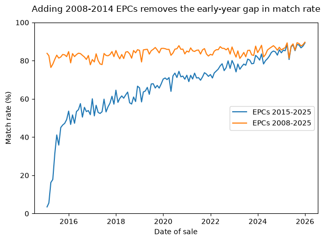

# Oxfordshire house sales joined to energy certificates

This project links every residential sale in Oxfordshire from 2015 to 2025 (HM Land Registry Price Paid Data) to the property's Energy Performance Certificate (EPC), so that each sale has floor area, room counts, energy rating and building age with its price. Price Paid Data alone has no information about the size or condition of a property, so the join is to make later analysis like £/m² possible.

The two datasets share no common ID for historical sales, so they are matched on address. The pipeline cleans both datasets, matches them, picks the most relevant EPC record for each sale and writes out a single cleaned table.

I built this as part of a self-directed data science training plan. The working notes for each stage are in `logs/`.

## Data

Neither dataset is included in the repo. To reproduce the results:

**Price Paid Data.** Use the [report builder](https://landregistry.data.gov.uk/app/ppd) and run one search per district: Cherwell, Oxford, South Oxfordshire, Vale of White Horse and West Oxfordshire. Set the dates to 1 Jan 2015 to 31 Dec 2025, choose "all" results, and download as CSV with headers. Save the five files in `data/raw/` with names starting `ppd_data` (unchanged from downloads). Field definitions are on the [Land Registry guidance page](https://www.gov.uk/guidance/about-the-price-paid-data).

**Energy Performance Certificates.** Download from [Get energy performance of buildings data](https://get-energy-performance-data.communities.gov.uk/) (you need a GOV.UK One Login account). Select domestic certificates lodged between Sept 2008 (the start of the register) and Dec 2025 for the same five local authorities. Certificates are valid for 10 years, so sales from 2015 onwards can depend on certificates lodged well before 2015. Save the CSV in `data/raw/` as `EDC_OXFORDSHIRE_2008_2025.csv`, or change `EPC_FILENAME` in `src/cleaning/config.py`. A data dictionary with definitions for the columns can be found at [Link to Domestic EPC Data Dictionary](https://get-energy-performance-data.communities.gov.uk/guidance/data-dictionary).

Contains HM Land Registry data © Crown copyright and database right 2021. This data is licensed under the Open Government Licence v3.0.

## Running it

Python 3.14 with pandas and pyarrow:

```
pip install -r requirements.txt
python run_pipeline.py
```

Run from the project root. It takes a few minutes, mostly spent on the address matching, and prints a timestamped progress line as each step finishes. The cleaned table (114,424 sales, 44 columns) is saved as Parquet in `data/processed/`, and a report of row counts at each step is printed to the terminal.

## How the matching works

1. Address fields on both sides are tidied (whitespace, commas, case) and each address is turned into a set of words, including the postcode.
2. Every sale is paired with every certificate at the same postcode.
3. A pair counts as a match if all the words in the Land Registry address appear in the EPC address. A subset test rather than an exact match is needed because EPC addresses sometimes include extra words such as the post town.
4. Sales that match more than one distinct property are dropped as ambiguous.
5. Where a property has several certificates, the one inspected closest before the sale is kept. Certificates from after the sale are not used, since the property may have changed. Certificates more than 10 years old at the time of sale are kept but flagged in an `EPC_expired` column.
6. Invalid values are set to missing, a few implausible records are excluded (including those with no floor area), and missing floor heights are filled with the median (with a flag column).

## Results

| | Sales | % of all sales |
|---|---|---|
| All sales 2015–2025 | 135,557 | 100% |
| Address matched to an EPC | 119,532 | 88.2% |
| After dropping ambiguous matches | 118,222 | 87.2% |
| With a certificate from before the sale | 114,490 | 84.5% |
| Final, after exclusions | 114,424 | 84.4% |

For comparison, a published linkage of the same datasets for England and Wales (Chi et al., 2021) matched 93% of 2011–2019 sales before cleaning, also using EPCs from 2008. The figures aren't directly comparable: the UCL study covers different years and a national area, and it picks the closest certificate before or after the sale, whereas this pipeline only uses certificates from before the sale.

Chi, B., Dennett, A., Oléron-Evans, T. and Morphet, R. (2021). "A new attribute-linked residential property price dataset for England and Wales, 2011–2019." UCL Open: Environment, 2(7), 1–25. [DOI link to paper at publisher](https://doi.org/10.14324/111.444/ucloe.000019) [Repository version](https://pmc.ncbi.nlm.nih.gov/articles/PMC10208353/pdf/ucloe-03-019.pdf)

## Extending EPC coverage back to 2008

The first version of the pipeline used EPCs lodged from 2015 only, and matched 67.2% of sales. The match rate rose steadily with sale year: 3.5% in January 2015 (35.5% across 2015), rising to 87.1% in 2025. Certificates are valid for 10 years, so many early sales relied on certificates issued before 2015, which weren't in the extract.

Re-running the pipeline with certificates from the start of the register (Sept 2008) raised the overall match rate to 84.4% and removed most of the upward trend with time. The 2015 rate rose from 35.5% to 81.9%, while 2025 changed by about one percentage point.



The comparison is in `notebooks/part_6_epc_2008-2025_extension.ipynb`, with findings and decisions in `logs/part_6_2008-2025_epc_extension.md`. The original version is preserved under the tag [`v1-2015-epc`](https://github.com/TomSCarter/land-registry-cleaning-pipeline/tree/v1-2015-epc).

## Limitations

- **The match rate still rises slightly with sale year,** from 81.9% in 2015 to 87.9% in 2025. Some early sales probably depend on certificates that predate the register.
- **1,151 sales use a certificate more than 10 years old,** flagged in `EPC_expired`. Filter on it if certificate validity matters for your analysis.
- **Matching on word sets loses repeated words.** An address like "Riverside Court 9 9 West Way" becomes the same set as the block's address without the flat number, which makes it ambiguous. These cases are dropped rather than resolved.
- **Short addresses can match unrelated longer ones** at the same postcode (for example "4 Churchill Road" and "Apartment 4, The Lofts, 7 Churchill Road"). Most of these show up as ambiguous and are dropped.
- **New-build certificates don't record room counts,** so about 28% of the final table has no room count. Floor area is complete and is the better size measure.
- **Tenure is missing for about 30.5% of sales,** mostly because older certificates (pre-2015) often don't record it.
- **Some sales had two certificates tied for closest inspection date.** The more recently lodged one is used.

## Structure

```
├── run_pipeline.py        # creates the pipeline, runs it, prints the report
├── export_pre_clean.py    # runs stages 1-4 only and saves the pre-clean data
├── requirements.txt
├── src/cleaning/          # config, load, normalise, match, features, clean, save, pipeline
├── notebooks/             # exploration and development, one per stage
├── logs/                  # notes and decisions for each stage
│   └── figures/           # charts used in the logs and this README
└── data/                  # raw, interim and processed (not tracked)
```
Notebooks for parts 1–5 were developed on the 2015–2025 EPC extract, and their saved outputs reflect that version. Part 6 compares the two versions.

`export_pre_clean.py` produces the input for a Power Query re-implementation of the cleaning stage, in [powerbi_training_log](https://github.com/TomSCarter/powerbi_training_log).

## Licence

Code is MIT licensed. The data is not included and is subject to its own licences (see Data above).
